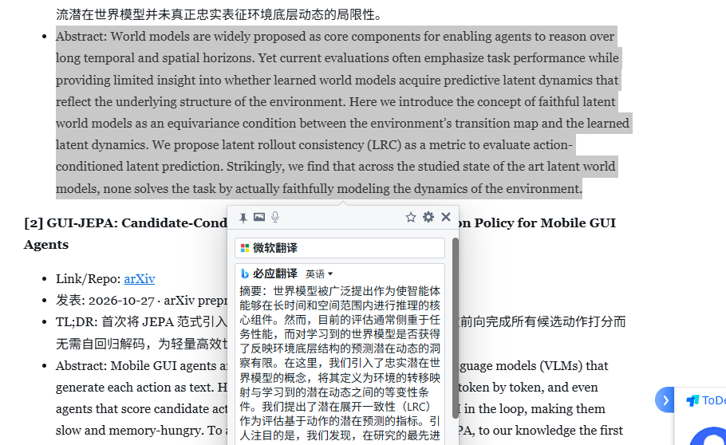
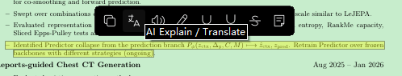
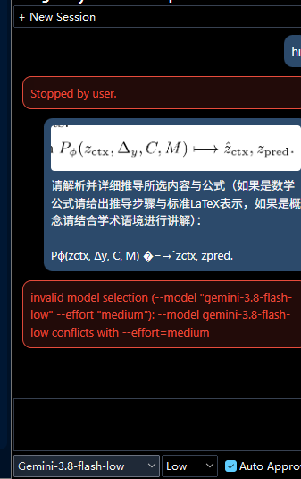
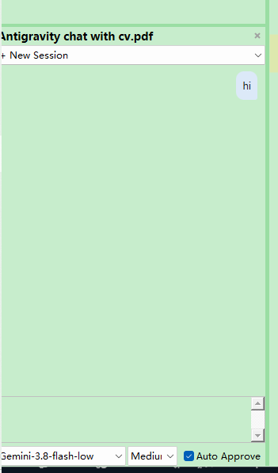

# SumatraPDF 集成 AI 助手与非模态划词翻译

[](https://github.com/sumatrapdfreader/sumatrapdf/actions/workflows/build.yml)
[](https://www.gnu.org/licenses/gpl-3.0)

---

## 核心特性 (Key Features)

- **划词非模态悬浮翻译 (Selection Translation)**  
    
  *在阅读论文时划选任意段落即可唤起轻量工具栏；点击翻译图标将在原文旁弹出非模态翻译气泡，不阻塞主界面滚动与查看，告别繁琐的浏览器跳转。*

- **多后端 AI 深度解析助手 (Multi-Engine AI Chat & Document Assistant)**  
    
  *针对复杂的学术公式与难懂概念，点击解析即可将上下文推送至侧边 AI Chat 栏，支持标准 LaTeX 数学公式离线渲染推导与背景答疑。*

- **模型名称与思考深度解耦 (Decoupled Model Selection & Reasoning Effort)**  
    
  *将模型型号与思考算力等级（Low / Medium / High / Disabled）拆分为独立控件，彻底避免底层 CLI 参数冲突，按需灵活调控推理深度。*

- **Agent 会话隔离防污染 (Isolated Agent Sessions & Anti-Pollution)**  
    
  *调用本地 Agent 时自动启用独立命名空间沙盒（`--project sumatrapdf`），阅读时的查词与临时对话完全与日常终端历史会话隔离。*

---

## 配置说明 (Configuration Reference)

在 `SumatraPDF-settings.txt` 中（或通过 **设置 -> 高级选项**）进行自定义配置：

```txt
AiChat [
	Enabled = true
	Provider = antigravity     # 可选：gemini (直连), antigravity, claude, codex, grok
	Model = gemini-2.5-flash
	Effort = medium            # 可选：low, medium, high, disabled
	ApiKey =                   # 使用 Gemini REST 直连时填入 API 密钥
	AutoApprove = true
	TranslateLanguage = zh-CN  # 默认翻译目标语言
]

SelectionTranslate [
	Enabled = true
	AutoPopup = false          # 选中文字后是否自动弹出翻译气泡
	DefaultTargetLang = zh-CN
	Pinned = false             # 默认是否钉住悬浮窗
]
```

---

## 从源码编译 (Building from Source)

### 环境准备
- Visual Studio 2022 / Build Tools（需勾选 C++ 桌面开发套件）
- Node.js（用于资源预打包脚本）
- Git

### 编译步骤

1. **拉取代码：**
   ```cmd
   git clone https://github.com/muxin-wei/sumatrapdf.git
   cd sumatrapdf
   ```

2. **预打包离线静态资源（KaTeX 与 UI 脚本）：**
   ```cmd
   cmd\pack-embedded-prebuild.cmd
   ```

3. **编译 64 位 Release 版本：**
   ```cmd
   call "C:\Program Files (x86)\Microsoft Visual Studio\2022\BuildTools\VC\Auxiliary\Build\vcvarsall.bat" x64
   msbuild /m /p:Configuration=Release /p:Platform=x64 vs2022\SumatraPDF.sln
   ```

编译完成后，可执行程序与依赖动态库位于 `out\rel64\SumatraPDF.exe` 与 `out\rel64\libsumatrapdf.dll`。

---

## 开源协议 (License)

SumatraPDF 基于 **GNU General Public License v3 (GPLv3)** 开源发布。部分第三方子组件基于 BSD 或 MIT 协议分发（详见 [AUTHORS](AUTHORS)）。
