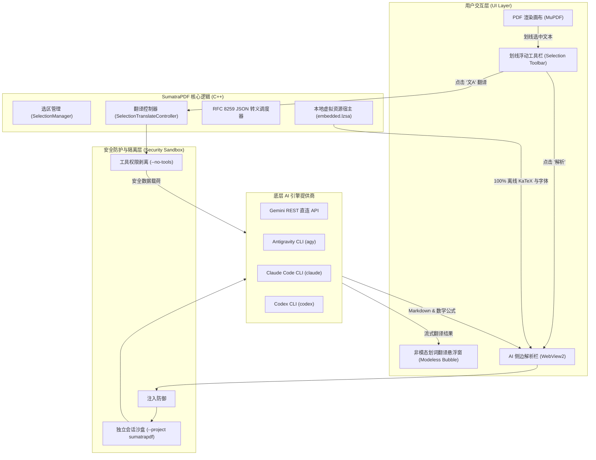

# SumatraPDF 集成 AI 助手与非模态划词翻译

[](https://github.com/sumatrapdfreader/sumatrapdf/actions/workflows/build.yml)
[](https://www.gnu.org/licenses/gpl-3.0)
[](#5-100-%E7%A6%BB%E7%BA%BF%E5%86%85%E5%B5%8C%E9%9D%99%E6%80%81%E8%B5%84%E6%BA%90%E5%8C%85-katex--markdown)

本项目为 **SumatraPDF** 的高生产力增强分支，专为学术文献、论文精读与专业技术文档打造。集成了 **类 Chrome 悬浮划词翻译框**、**多后端 AI 深度讲解侧边栏**、**100% 离线内嵌 KaTeX 数学公式渲染** 以及 **多层防御间接提示注入 (IPI) 的安全体系**。

---

## 目录

- [核心功能与亮点](#核心功能与亮点)
  - [1. 类 Chrome 划词非模态悬浮翻译框](#1-类-chrome-划词非模态悬浮翻译框)
  - [2. 独立解耦的翻译与 AI 深度解析](#2-独立解耦的翻译与-ai-深度解析)
  - [3. 模型名称与思考算力 (Effort) 独立解耦](#3-模型名称与思考算力-effort-独立解耦)
  - [4. Agent 会话隔离与防污染机制](#4-agent-会话隔离与防污染机制)
  - [5. 100% 离线内嵌静态资源包 (KaTeX / Markdown)](#5-100-离线内嵌静态资源包-katex--markdown)
  - [6. 网络与文档安全体系 (防御恶意 Prompt / 水印劫持)](#6-网络与文档安全体系-防御恶意-prompt--水印劫持)
- [系统架构图](#系统架构图)
- [配置说明 (Settings)](#配置说明-settings)
- [从源码编译](#从源码编译)
- [开源协议](#开源协议)

---

## 核心功能与亮点

### 1. 类 Chrome 划词非模态悬浮翻译框
- **非阻塞交互 (Modeless)**：选中文本后悬浮工具条弹出。点击翻译按钮（`文A`），弹出轻量级翻译悬浮气泡，不会阻塞主窗口，允许用户同时对照阅读 PDF 原文并自由滚动/缩放。
- **自动失焦销毁与钉住模式 (Pin)**：点击空白区域气泡自动关闭；点击钉住按钮（`📌`）可将其固定于屏幕上，便于跨段落、跨页面对比参考。
- **轻量原生渲染**：采用轻量级 Win32 + DirectWrite / GDI 混合绘制与自适应暗色/浅色主题，毫秒级响应。

### 2. 独立解耦的翻译与 AI 深度解析
- **翻译与讲解明确分工**：
  - 点击工具栏 **翻译图标 (`文A`)**：仅调用快速直译链路，不触发冗长思考与长篇大论。
  - 点击工具栏 **解析图标 (`📋` / AI Explain)**：将包含公式、上下文的学术段落推送至侧边 AI Chat 窗口进行深度推导、数学证明与背景解析。

### 3. 模型名称与思考算力 (Effort) 独立解耦
- **独立下拉选项**：将 **模型名称**（如 `gemini-2.5-flash`、`gemini-2.5-pro`、`claude-3-7-sonnet` 等）与 **思考算力**（`Low`、`Medium`、`High`、`Disabled`）彻底分离。
- **杜绝参数冲突**：彻底解决了此前因将 `gemini-3.8-flash-low` 拼入模型名称，导致与底层 CLI 的 `--effort medium` 冲突报错的问题。

### 4. Agent 会话隔离与防污染机制
- **专属工作区隔离 (`--project sumatrapdf`)**：调用本地 CLI Agent（如 `agy`、`claude`、`codex` 等）时，自动分配独立的项目命名空间与会话标签。
- **保护用户主 Agent 体验**：避免高频次的查词、单句翻译污染主终端的用户历史会话列表，确保终端的 `resume` 与 session 管理保持干净清爽。

### 5. 100% 离线内嵌静态资源包 (KaTeX / Markdown)
- **零外部网络依赖**：将 KaTeX 完整套件静态内嵌至程序二进制资源的 `embedded.lzsa` 中：
  - `katex.min.js` (v0.16.21)
  - `auto-render.min.js`
  - `katex.min.css`
  - 完整 20 个 WOFF2 数学字体文件（包含 `KaTeX_Main`, `KaTeX_Math`, `KaTeX_AMS`, `KaTeX_SansSerif` 等）
- **真正的离线断网可用**：彻底移除 `cdn.jsdelivr.net` 外部 CDN 请求，在飞机、高铁或企业内网隔离保密环境（Air-gapped）下均可完美渲染 LaTeX 公式。

### 6. 网络与文档安全体系 (防御恶意 Prompt / 水印劫持)
- **禁用翻译 Agent 工具权限 (Disarm Tools)**：在进行划线翻译时，强制传递 `--no-tools` 限制，剥夺 Agent 的命令行执行与本地文件写入权限，防止恶意 PDF 中的隐藏提示注入劫持本地系统。
- **文档隔离边界 (`<untrusted_document_content>`)**：所有选中文本均使用 XML 语义标签进行强制隔离，并在系统提示词中声明其仅为被动翻译/解析数据，无权发出指令。
- **RFC 8259 严格 JSON 转义**：所有 C++ 与 WebView2 之间的交互数据均经过严格转义，杜绝 DOM-XSS 与脚本注入漏洞。
- **WebView2 虚拟主机源锁定**：限制 WebView2 仅加载本地虚拟资源，阻断跨域外部脚本注入。

---

## 系统架构图



---

## 配置说明 (Settings)

在 `SumatraPDF-settings.txt` 中（或通过 **设置 -> 高级选项**）进行自定义配置：

```txt
AiChat [
	Enabled = true
	Provider = antigravity     # 可选：gemini (直连), antigravity, claude, codex, grok
	Model = gemini-2.5-flash
	Effort = medium            # 可选：low, medium, high, disabled
	ApiKey =                   # 使用 Gemini REST 直连时填入 API 密钥
	AutoApprove = true
	TranslateLanguage = zh-CN  # 默认翻译目标语言
]

SelectionTranslate [
	Enabled = true
	AutoPopup = false          # 选中文字后是否自动弹出翻译气泡
	DefaultTargetLang = zh-CN
	Pinned = false             # 默认是否钉住悬浮窗
]
```

---

## 从源码编译

### 环境准备
- Visual Studio 2022 / Build Tools（需勾选 C++ 桌面开发套件）
- Node.js（用于资源预打包脚本）
- Git

### 编译步骤

1. **拉取代码：**
   ```cmd
   git clone https://github.com/muxin-wei/sumatrapdf.git
   cd sumatrapdf
   ```

2. **预打包离线静态资源（KaTeX 与 UI 脚本）：**
   ```cmd
   cmd\pack-embedded-prebuild.cmd
   ```

3. **编译 64 位 Release 版本：**
   ```cmd
   call "C:\Program Files (x86)\Microsoft Visual Studio\2022\BuildTools\VC\Auxiliary\Build\vcvarsall.bat" x64
   msbuild /m /p:Configuration=Release /p:Platform=x64 vs2022\SumatraPDF.sln
   ```

编译完成后，可执行程序与依赖动态库位于 `out\rel64\SumatraPDF.exe` 与 `out\rel64\libsumatrapdf.dll`。

---

## 开源协议

SumatraPDF 基于 **GNU General Public License v3 (GPLv3)** 开源发布。部分第三方子组件基于 BSD 或 MIT 协议分发（详见 [AUTHORS](AUTHORS)）。
