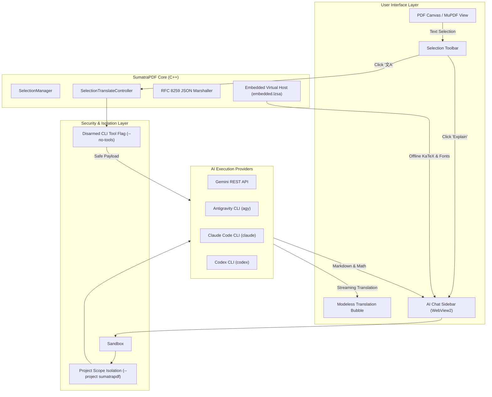

# SumatraPDF with AI Copilot & Modeless Translation

[](https://github.com/sumatrapdfreader/sumatrapdf/actions/workflows/build.yml)
[](https://www.gnu.org/licenses/gpl-3.0)
[](#100-offline-static-asset-pipeline)

An enhanced, production-grade fork of **SumatraPDF** featuring an integrated **AI Reading Assistant**, **Chrome-style Modeless Selection Translation Bubble**, **100% Air-gapped Offline KaTeX Math Rendering**, and a **Multi-layered Cybersecurity Architecture** for safe paper reading and document analysis.

---

## Table of Contents

- [Key Features](#key-features)
  - [1. Chrome-Style Modeless Selection Translation](#1-chrome-style-modeless-selection-translation)
  - [2. Multi-Engine AI Chat & Document Assistant](#2-multi-engine-ai-chat--document-assistant)
  - [3. Decoupled Model Selection & Reasoning Effort](#3-decoupled-model-selection--reasoning-effort)
  - [4. Isolated Agent Sessions & Anti-Pollution](#4-isolated-agent-sessions--anti-pollution)
  - [5. 100% Offline Static KaTeX & Markdown Rendering](#5-100-offline-static-katex--markdown-rendering)
  - [6. Multi-Layer Security & Indirect Prompt Injection (IPI) Defense](#6-multi-layer-security--indirect-prompt-injection-ipi-defense)
- [System Architecture](#system-architecture)
- [Configuration Reference](#configuration-reference)
- [Building from Source](#building-from-source)
- [License](#license)

---

## Key Features

### 1. Chrome-Style Modeless Selection Translation
- **Non-blocking Floating Bubble**: Selecting text displays an unobtrusive hover toolbar. Clicking **Translate** (`文A`) launches an anchored, modeless popup bubble rather than locking the entire window or launching external browser tabs.
- **Concurrent Reading**: The user can continue scrolling, zooming, or selecting text in the underlying PDF while the translation bubble is open.
- **Auto-Dismiss & Pin Support**: Click outside the bubble to dismiss it instantly, or click the Pin button (`📌`) to keep it floating during cross-paragraph analysis.
- **Separation of Concerns**: Dedicated **Translate** button strictly performs accurate text translation; dedicated **AI Explain** button triggers contextual derivation and formulas in the AI Chat Panel.

### 2. Multi-Engine AI Chat & Document Assistant
- **Direct Cloud API**: Native Gemini REST API support with streaming responses and zero CLI overhead.
- **Local Agent CLI Integration**: Direct integration with local coding/research agents:
  - Google Antigravity CLI (`agy`)
  - Anthropic Claude Code (`claude`)
  - OpenAI Codex (`codex`)
  - Grok CLI (`grok`)
- **Rich Document Context**: Selected passages, formulas, equations, and page snapshots are delivered to the model with structured academic framing.

### 3. Decoupled Model Selection & Reasoning Effort
- **Orthogonal Controls**: Separate dropdowns for **Model Name** (`gemini-2.5-flash`, `gemini-2.5-pro`, `claude-3-7-sonnet`, etc.) and **Thinking Effort** (`Low`, `Medium`, `High`, `Disabled`).
- **Conflict Prevention**: Fixes CLI argument collisions where unified strings (e.g. `gemini-3.8-flash-low`) would conflict with explicit `--effort medium` flags.

### 4. Isolated Agent Sessions & Anti-Pollution
- **Scoped Agent Workspaces**: CLI invocations specify `--project sumatrapdf` and dedicated session tags.
- **Session Hygiene**: Prevents automated document translation and sidebar queries from flooding the user's primary agent conversation logs or interfering with external `resume` workflows.

### 5. 100% Offline Static KaTeX & Markdown Rendering
- **Zero External Dependencies**: All rendering assets are bundled into SumatraPDF's native resource block (`embedded.lzsa` / `IDR_EMBEDDED_PAK`):
  - `katex.min.js` (v0.16.21)
  - `auto-render.min.js`
  - `katex.min.css`
  - Complete set of 20 WOFF2 mathematical font files (`KaTeX_Main`, `KaTeX_Math`, `KaTeX_AMS`, etc.)
- **Air-Gap Capable**: No connections to external CDNs (`cdn.jsdelivr.net`). Safe for isolated enterprise environments and offline travel.

### 6. Multi-Layer Security & Indirect Prompt Injection (IPI) Defense
- **Disarmed Translation Agent Tools**: Prevents models from executing shell commands or filesystem mutations when translating untrusted text from untrusted PDFs.
- **Untrusted Document Tagging**: Selected text is strictly wrapped in `<untrusted_document_content>` XML boundaries with strict system prompt directives instructing models to treat embedded instructions as passive data.
- **RFC 8259 Compliant JSON Escaping**: All inter-process communication between C++ and WebView2 uses strict JSON escaping, eliminating DOM-XSS and script injection attack vectors.
- **WebView2 Origin Locking**: Remote navigation is blocked; WebView2 is locked to the local virtual domain.

---

## System Architecture



---

## Configuration Reference

Edit `SumatraPDF-settings.txt` (or via **Settings -> Advanced Options**):

```txt
AiChat [
	Enabled = true
	Provider = antigravity     # Options: gemini, antigravity, claude, codex, grok
	Model = gemini-2.5-flash
	Effort = medium            # Options: low, medium, high, disabled
	ApiKey =                   # For direct Gemini REST API
	AutoApprove = true
	TranslateLanguage = zh-CN  # Default translation target
]

SelectionTranslate [
	Enabled = true
	AutoPopup = false          # Show bubble immediately on selection
	DefaultTargetLang = zh-CN
	Pinned = false
]
```

---

## Building from Source

### Prerequisites
- Visual Studio 2022 / Build Tools (with C++ Desktop workload)
- Node.js (for asset preparation)
- Git

### Build Steps

1. **Clone the repository:**
   ```cmd
   git clone https://github.com/muxin-wei/sumatrapdf.git
   cd sumatrapdf
   ```

2. **Pack embedded offline assets (KaTeX & UI scripts):**
   ```cmd
   cmd\pack-embedded-prebuild.cmd
   ```

3. **Compile Release x64 binary:**
   ```cmd
   call "C:\Program Files (x86)\Microsoft Visual Studio\2022\BuildTools\VC\Auxiliary\Build\vcvarsall.bat" x64
   msbuild /m /p:Configuration=Release /p:Platform=x64 vs2022\SumatraPDF.sln
   ```

The compiled binaries will be generated under `out\rel64\SumatraPDF.exe` and `out\rel64\libsumatrapdf.dll`.

---

## License

SumatraPDF is released under the **GNU General Public License v3 (GPLv3)**. Some third-party subcomponents are distributed under BSD or MIT licenses (see [AUTHORS](AUTHORS)).
